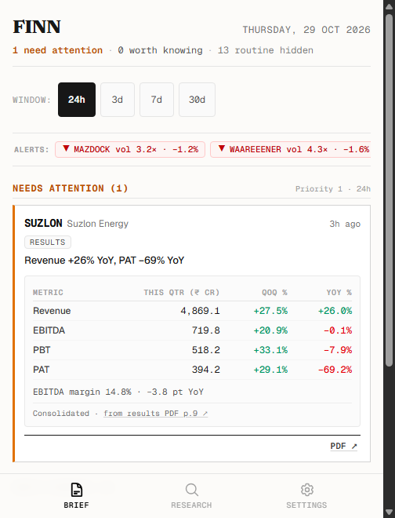
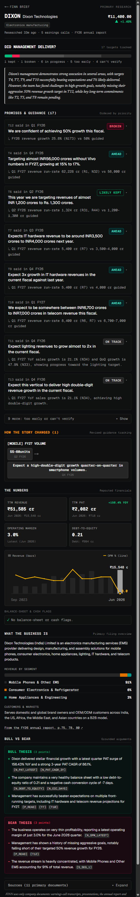
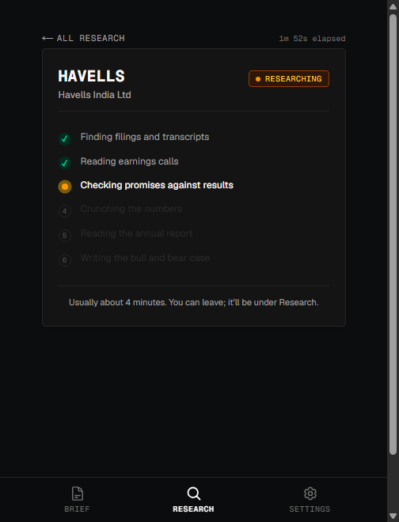
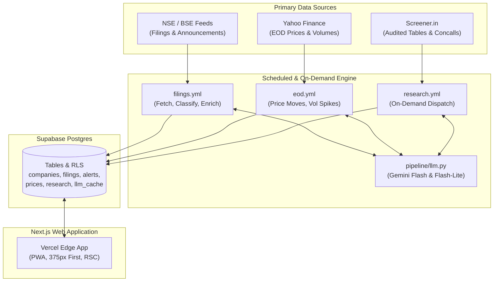

# FINN — Investment Intelligence Agent

FINN is a mobile-first investment intelligence agent for Indian public-markets investors. It operates in two complementary modes: **Push** delivers a ranked, newspaper-calm morning brief of material exchange filings across an 18-stock portfolio alongside volume spikes and day price moves; **Pull** performs on-demand corporate research on any NSE ticker, extracting numeric management commitments from concall transcripts, cross-checking them against audited financial tables, and delivering an unforgiving "promised vs. delivered" scorecard. Built exclusively from verified primary documents—earnings transcripts, exchange filings, annual reports, and screener.in financials—with zero broker research, news commentary, or web search hallucinations.

**Live Application:** [https://finn-lovat-two.vercel.app](https://finn-lovat-two.vercel.app)

---

## Screen Highlights

| Morning Brief (375 px) | Company Scorecard (/c/DIXON) | Research Progress |
| :---: | :---: | :---: |
|  |  |  |

---

## Architecture



---

## Model Routing & Cost Efficiency

* **Model Routing:**
  * `models.bulk` (`gemini-flash-lite-latest`): Classifies filings, extracts verbatim guidance quotes from earnings transcripts, and digests annual reports.
  * `models.reasoning` (`gemini-flash-latest`): Evaluates target achievement against audited figures, synthesizes management reads, and generates bull/bear theses.
* **₹0 Total Cost:**
  * **Deterministic Caching:** Every LLM call passes through `pipeline/llm.py` and is indexed in `llm_cache` by content hash `(model, prompt_version, input)`. Duplicate inputs hit cache with zero API overhead.
  * **Rule Pre-filtering:** Rule-based heuristics filter out 80%+ of administrative filings before calling LLMs.
  * **Targeted PDF Processing:** PDFs are only downloaded and converted to text when relevant; text excerpts are verified locally in Python before prompt construction.

---

## Promised vs. Delivered Engine

The guidance tracking pipeline executes in five strict phases:
1. **Extract (`models.bulk`):** Parses earnings concalls for explicit numeric targets and operational milestones.
2. **Quote Verification (Python):** Verifies that extracted quotes exist verbatim in the source transcript PDF. Hallucinated quotes are dropped immediately.
3. **Target Grouping & Revisions (Python):** Groups identical metrics and periods across successive quarterly calls to construct "How the story changed" revision chains.
4. **Judge (`models.reasoning`):** Cross-checks commitments against audited financials and operational milestones.
5. **Deterministic Rule Overrides (Python):**
   * *Metric Direction:* Higher is better for revenue, margins, volumes, and order books; lower is better for credit costs; capex is strictly neutral (`above_plan`, `within_plan`, `below_plan`).
   * *Period Inclusion:* Evidence period must fall strictly inside target period (e.g. FY26 evidence cannot satisfy an FY27 target).
   * *Segment Matching:* Divisional targets require matching divisional evidence; company-wide metrics cannot fulfill segment targets.
   * *Milestone Content Overlap:* Requires $\ge 0.2$ content-word overlap between promise and filing event.
   * *Tolerance Bands:* Strict $\pm 5\%$ tolerance for point guidance; range bounds for intervals; flags PAT growth exceeding operational growth by $\ge 50$ pts.

---

## Repository Map

* `pipeline/`: Data ingestion, filing classification, volume/price alerts, and LLM router (`llm.py`, `fetch_filings.py`, `alerts.py`).
* `research/`: On-demand primary research engine (`build_corpus.py`, `promises.py`, `numbers.py`, `snapshot.py`, `run.py`).
* `web/`: Mobile-first Next.js 16 app with React Server Components, Tailwind CSS, and PWA manifest.
* `supabase/`: Database schema, indexes, and row-level security (`001_init.sql`, `002_research.sql`).
* `.github/workflows/`: Automation pipelines (`filings.yml`, `eod.yml`, `research.yml`).
* `docs/`: Phase prompts, evaluation rules, and mobile screenshots (`docs/screenshots/`).

---

## Run It Yourself

```bash
# 1. Clone repository
git clone https://github.com/UwUBabushkaUwU/finn.git
cd finn

# 2. Configure environment
cp .env.example .env
# Fill in GEMINI_API_KEY, SUPABASE_URL, SUPABASE_SECRET_KEY, NEXT_PUBLIC_SUPABASE_*, GH_DISPATCH_TOKEN

# 3. Apply database migrations
# Run supabase/migrations/001_init.sql and 002_research.sql in your Supabase SQL editor

# 4. Install dependencies and seed portfolio
pip install -r requirements.txt
python -m pipeline.seed

# 5. Run research engine for a ticker
python -m research.run --ticker DIXON

# 6. Start the web application
cd web
npm install
npm run dev
```

---

## Known Limits

* Concall guidance extraction requires explicit numbers or concrete milestones; vague managerial optimism is deliberately classified as unverifiable.
* Exchange filing feeds rely on scheduled polling intervals (15–30 min) rather than sub-second direct exchange socket drops.
* Annual report snapshot parsing processes key management discussion and segment reporting pages, bypassing boilerplate disclosures.
* Single-user prototype model: RLS permits anonymous read access and threshold updates to `settings` row `id = 1`.
* Initial research compilation takes 3–4 minutes per company to fetch transcripts, extract quotes, cross-check audited screener tables, and produce verdicts.

